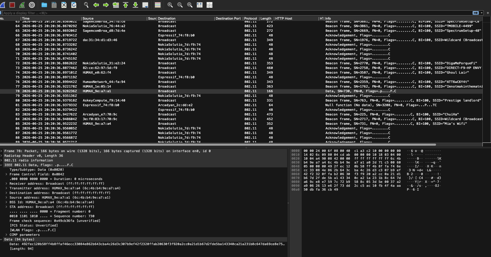
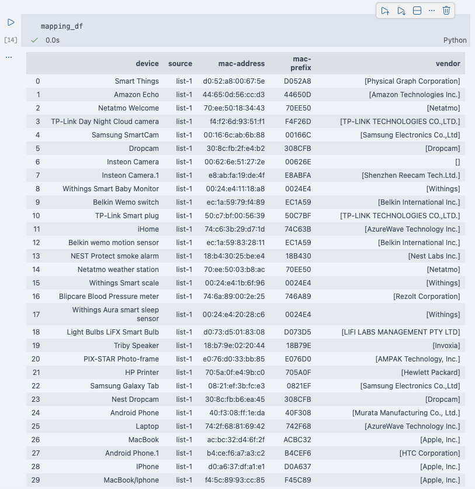

# June 26th, 2026
## MAC address observation
- Sniffing 802.11 connection gives you frame package. I can only see the MAC address and other frame level and layer-2 looking like information
    - I do not see anything useful but the MAC address, and frame size
    - Anything from layer 3 onward are WPA/WPA2 encrypted. No access.
- MAC address: 
    - The first 6 hexadecimal digits identify the **manufacturer**, called the OUI (Organizational Unique Identifier). IEEE Registration Authority assigns these MAC prefixes to its registered vendors.

- Looking into the MAC address used in both dataset, these are my observations:
    - Occasionally, devices belong to the same vendor have the same first 6 MAC digits i.e:
        - Withings:
            - Smart Baby Monitor
            - Smart Scale
            - Smart Sleep Sensor
        - Geeni
            - Camera 2
            - Camera 3
        - NEST
            - Smoke alarm
            - Camera
        - Netatmo
            - Welcome
            - Weather Station
        - Belkin Wemo
            - Switch
            - Motion Sensor
- Based on my observation, it is very likely that the OUI can be used to uniquely identify *\<device, vendor\>* tuple
- Occasionally, some of different devices belong to the same vendor also share OUI tuple
- However, there are also edge cases where devices belongs to the same vendor, even the same type, have different OUI. 
- <mark>TO-DO</mark>:
    - Research to see if OUI can be used to uniquely identify *\<device, vendor\>*
    - On layer 2, we can only see MAC address, probably try ML on packet length, direction, potentially inter-arrival time if we can use that to identify anything

## References
- [What is MAC Address?](https://www.geeksforgeeks.org/computer-networks/mac-address-in-computer-network/)

# June 29th, 2026
- We might be able to use MAC prefixes to trace back to the network card manufacturer. We might be able to identify the device type and vendor with MAC prefixes but there is no guarantee.
- Download OUI mapping and checking now: [IEEE OUI Database](https://standards-oui.ieee.org/)
- Result: 

- Observation:
    - Some manufacturers produce their own network card and register it under their name, while some uses third-party manufacturer.
    - Some manufacturers sign up for multiple entries. i.e: Amazon
- Conclusion:
    - We for sure will be able to identify **network-card-vendor**
- Question:
    - How do we define a **vendor**?
    - Turning on promicious mode, we can see source MAC address, destination MAC address, data size. Would that be sufficient for a ML threat model?
        - Most pcap file only lists packets constructed with Ethernet layer, not 802.11. Some does, but with different channels, i.e: 802.1Q Virtual LAN.
- Brainstorming:
    - What if we can add **network-card-vendor** as a feature assisting the vendor prediction? Why?
        - Some vendors produce their own network card -> strong correlation
        - Some vendors use third party network card + firmware (either from the chip manufacturer or the vendors) + software (vendors) -> One network card manufacturer works with a limited amount of IoT device manufacturer, which means we can narrow down the search space, and then *potentially* use ML on network traffic and pattern to figure out if this device belongs to a specific vendor?

## References
- [Leveraging MAC Address Logic for IoT Classification ](https://www.catonetworks.com/blog/leveraging-mac-address-logic-for-iot-classification/)
- [OUI Database](https://standards-oui.ieee.org/)

# June 30th, 2026
- Keep investigating if the monitor mode can give more information on other layers.
- Running monitor mode and watch a video from the phone to verify if the device is usuable

# July 1st, 2026
- Found one problem, I was listening on 2.4Ghz channel, which is why I can't listen to the traffic between my phone and the router
- What I did:
    - Run `sudo wdutil info` to figure out the **channel** and the **radio width**
    - Use **Wireless Diagnostic** and configure the **Sniffer** to listen on the above channel and radio width
    - The captured traffic will be exported to `/var/tmp`
- After doing that, I was able to capture all traffic between all devices on my LAN network.

# July 2nd, 2026
- One new issue, what's about multiple devices connecting through a hub?

# July 6th, 2026
